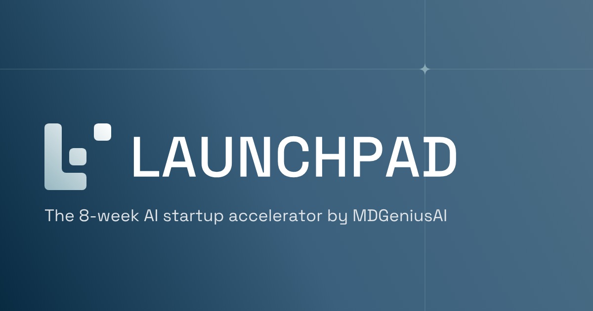

<p align="center">
  <a href="https://launchpad.mdgeniusai.com">
    <picture>
      <source media="(prefers-color-scheme: dark)" srcset="client/public/brand/launchpad-logo-reversed.svg">
      
    </picture>
  </a>
</p>

<p align="center">
  The platform behind the MDGeniusAI eight-week accelerator for founders building AI for healthcare.
</p>

<p align="center">
  <a href="https://launchpad.mdgeniusai.com"><strong>launchpad.mdgeniusai.com</strong></a>
  &nbsp;·&nbsp;
  <a href="https://github.com/Dev-Cartagena/MD_Genius_Launchpad/actions/workflows/ci.yml"></a>
  &nbsp;·&nbsp;
  English | Español
</p>

---

## Overview

MD Genius Launchpad runs the full accelerator in one place. Startups apply, are accepted
into a cohort and work through a week-by-week program, while mentors, investors and the
program team follow their progress.

| For | What they get |
|---|---|
| **Founders** | Application, weekly curriculum with lessons and quizzes, a personal roadmap, project workspace with files and readiness score, mentor booking and an AI Coach |
| **Mentors** | Mentee overview, session scheduling and a public mentor profile |
| **Investors** | A directory of the cohort's startups, interest tracking and meetings |
| **Program team** | Application review, cohorts, curriculum and roadmap templates, people and invitations, with a setup checklist for each new program |

The whole platform is bilingual. Interface, emails, AI Coach replies and program content
are available in English and neutral Latin American Spanish, and each person chooses
their language.

<p align="center">
  
</p>

## Technology

| Layer | Technology |
|---|---|
| Client | React 18, TypeScript, Vite, TanStack Query, Wouter, shadcn/ui, Tailwind CSS, react-i18next |
| API | Express on Node 22, Drizzle ORM, express-session with sessions in Postgres |
| Database | Postgres: Supabase in production, Docker locally |
| Files | Supabase Storage, private `uploads` bucket with signed URLs |
| Email | Resend (without a key, links are written to the log instead) |
| AI Coach | Claude via the Anthropic API (optional; the coach reports "not configured" without a key) |
| Hosting | Vercel: static client plus one serverless function for `/api/*` |

## Getting started

Requires Node 22 and Docker.

```bash
cp .env.example .env        # first time only; set SESSION_SECRET
npm install
npm run db:up               # Postgres 16 on localhost:5487
npm run db:migrate          # apply migrations
npm run dev:local           # http://localhost:5055
```

Register an account in the app, then make it an administrator:

```bash
docker compose exec -T db psql -U postgres -d launchpad \
  -c "update users set role='administrator' where email='you@example.com'"
```

Uploads, email and the AI Coach need the optional keys listed in `.env.example`.

## Tests and checks

```bash
npm run check   # TypeScript
npm test        # API, email, AI Coach and translation tests (launchpad_test database, created automatically)
npm run build   # client and self-hosted server bundle
```

CI (`.github/workflows/ci.yml`) runs all three on every pull request.

## Project structure

```
api/index.ts                  Vercel function entry (wraps the Express app)
server/app.ts                 Express app factory: middleware, auth, routes, errors
server/index.ts               Local or self-hosted server (API and client on one port)
server/routes.ts              REST API
server/storage.ts             Database queries
server/auth.ts                Sessions, sign-in state, isAuthenticated
server/fileStorage.ts         Supabase Storage uploads and downloads
server/email.ts               Password reset and invite emails, in English and Spanish
server/i18n/                  Spanish for API messages (middleware and dictionary)
server/translations.ts        Translatable fields per content type, and their sanitizer
server/rateLimit.ts           Postgres-backed rate limiting for auth endpoints
shared/schema.ts              Drizzle schema, Zod validation and shared types
migrations/                   SQL migrations (drizzle-kit)
client/src/i18n/              i18n setup and EN/ES catalogs (locales/{en,es}/<area>.json)
client/src/components/brand/  Logo, NodeRule, ProgramTrack, ProgressRing, ConnectorBadge, …
client/public/brand/          Logo files, generated by scripts/brand/build-logos.mjs
tests/                        API tests (vitest and supertest on real Postgres) and catalog checks
docs/                         Product requirements, design, Spanish style guide, project history
```

## Roles

`public_visitor` becomes `applicant` after submitting an application, then `participant`
after acceptance. `mentor`, `investor` and `administrator` are assigned by an
administrator.

## Design system

The interface follows the MDGeniusAI brand guideline. The plan and tokens are in
`docs/design/brand-redesign-plan.md`.

- **Color.** Tokens live in `client/src/index.css` as HSL channels, so modifiers such as
  `bg-primary/10` work. Navy `#082B42`, Steel `#3A607D`, Mist `#97B7C1` and White Smoke
  `#F3F3F3`. Muted text is `#5F6B74`, because Grey `#7F7F7F` fails AA contrast. The app
  is light-first.
- **Type.** Space Grotesk (`font-display`) for titles, interface and data; the Helvetica
  stack for body text and buttons.
- **Controls.** Based on the guideline's button samples: pill buttons (Steel→Navy
  primary, white→Mist secondary), 44px inputs, segmented pill tabs, and 16px cards with
  soft shadows.
- **Brand shapes.** Components in `client/src/components/brand`. Use `MistPanel` for at
  most one highlight per page, and `.hero-surface` or `.bg-brand-gradient` only for
  heroes and the sign-in panel. Status chips follow one rule: not started is dashed, in
  progress is Steel, done is Navy.
- **Icons.** Lucide at stroke 1.5, set globally.

## Languages

- Every interface string lives in `client/src/i18n/locales/{en,es}/<area>.json`, one
  catalog per area, and is used with `useTranslation("<area>")`. Keys are type-checked
  against the English catalog.
- Language is an account setting (`users.locale`, `PUT /api/auth/user/locale`) with an
  EN | ES switcher. Before sign-in the app uses the saved choice, then the browser
  language. Dates use `intlLocale()` (`es-419` or `en-US`).
- Program content (cohorts, modules, lessons, quizzes, milestones, roadmap templates and
  items) keeps Spanish in a `translations` jsonb column, `{ es: { title, … } }`. Render it
  with `useLocalized()` from `client/src/lib/localized.ts`, which falls back to English
  field by field. Quiz answers stay on the base questions.
- Stored values (statuses, roles, stages, options) are never translated; they are shown
  through label maps keyed by the stored value.
- `server/i18n` translates API messages for Spanish users. Emails and the AI Coach use
  each person's language.
- Spanish tone and glossary are in `docs/i18n/spanish-style-guide.md`: neutral Latin
  American, tú, respectful and professional.
- Tests enforce all of this:
  - `tests/i18n-catalogs.test.ts` checks both languages have the same keys and placeholders.
  - `tests/i18n-hardcoded.test.ts` fails on hard-coded screen text.
  - `tests/server-messages.test.ts` fails on server messages without Spanish.

## Database changes

1. Edit `shared/schema.ts`.
2. Run `npm run db:generate -- --name short_description` to create a SQL migration in
   `migrations/`.
3. Run `npm run db:migrate` to apply it locally, and commit the migration with the schema
   change.
4. Apply it to production before deploying code that depends on it:
   `DATABASE_URL="<session pooler URL>?sslmode=no-verify" npm run db:migrate`

Every table in `public` must have row level security enabled, because Supabase exposes
that schema through its public Data API. Migration `0001_lock_down_public_api` enables
it for existing tables and revokes the API roles' default privileges for new ones, and a
test fails if any table is missing it. New tables need
`ALTER TABLE ... ENABLE ROW LEVEL SECURITY` in the same migration.

## Deployment

Production runs at **https://launchpad.mdgeniusai.com**. A CNAME record for `launchpad`
in the mdgeniusai.com DNS (GoDaddy) points to Vercel, and
`md-genius-launchpad.vercel.app` redirects to the custom domain.

- **Vercel.** Project `md-genius-launchpad` (team `mdgeniusai`) builds the client with
  `npm run build:client` and deploys `api/index.ts` as the API function. Pushes to `main`
  deploy to production; other branches get preview deployments. Environment variables
  are set in Vercel; `.env.example` lists them all.
- **Supabase.** Project `md-genius-launchpad` in us-east-1. The runtime uses the
  transaction pooler (port 6543) with `DATABASE_SSL=require` and `DB_POOL_MAX=3`;
  migrations use the session pooler (port 5432).
- **ES modules.** Server-relative imports use `.js` extensions, because Vercel runs the
  compiled files as native ES modules.

---

<p align="center">
  <sub>MD Genius Launchpad · an MDGeniusAI program</sub>
</p>
